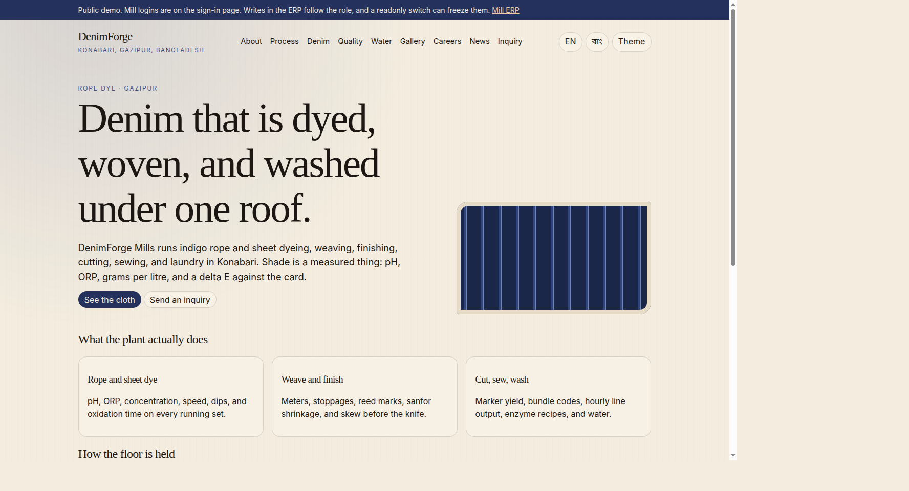
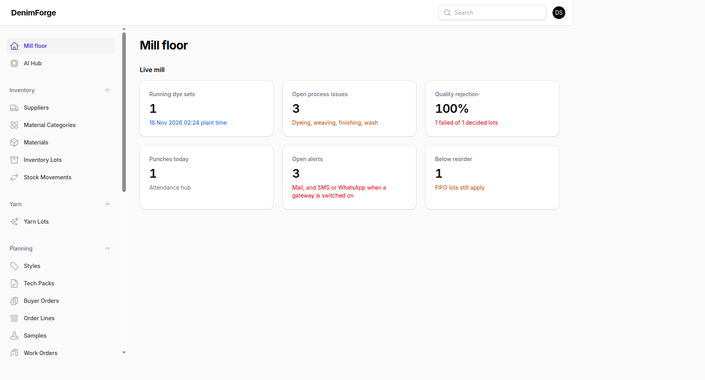
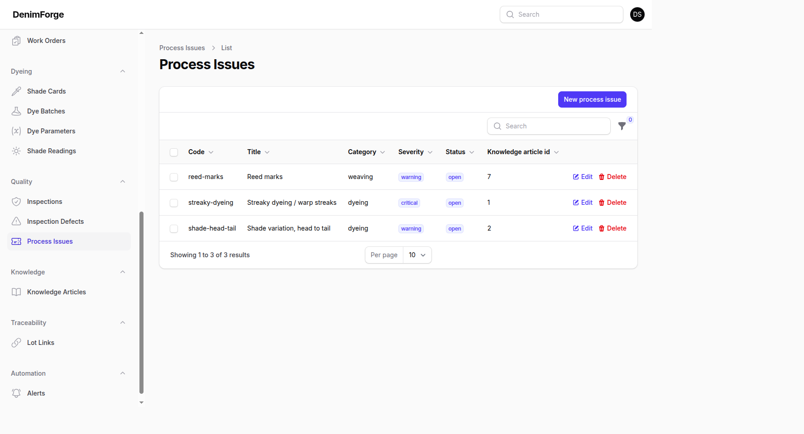
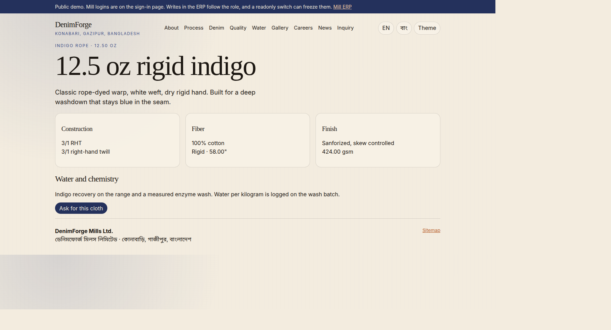
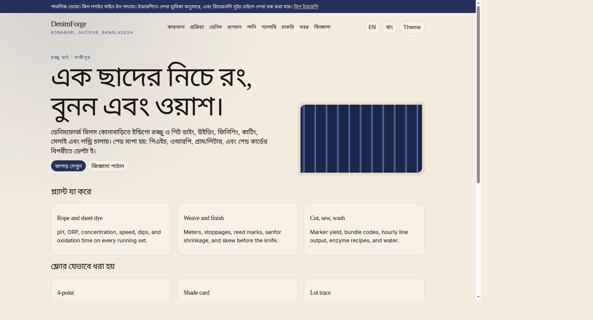
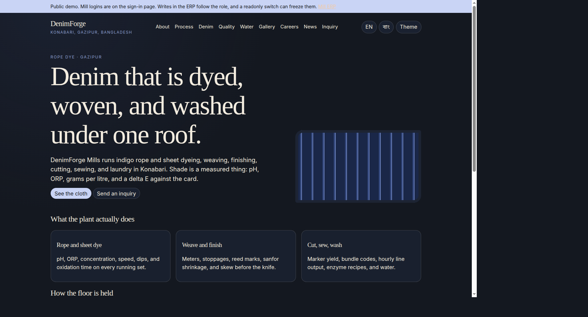
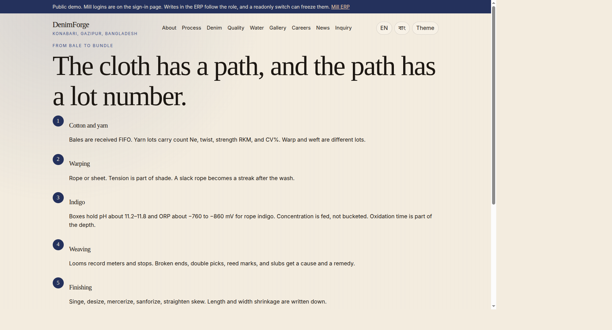
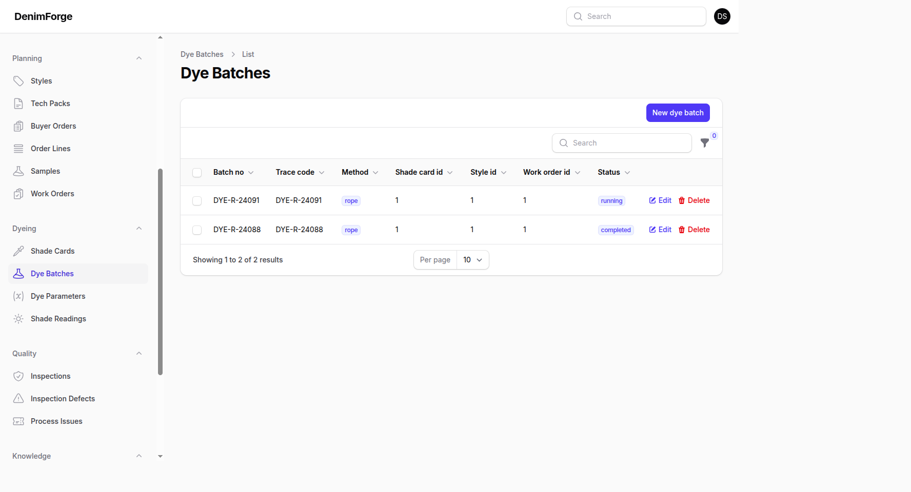

# DenimForge

A denim mill ERP and a public website in one Laravel application. Cotton comes in as a bale. The same lot number is still readable when a bundle reaches the wash. Shade, quality, and the production path sit in the middle. Everything else — yarn, looms, finishing, cutting, sewing, laundry, maintenance, costing, people, and the buyer — hangs off that path.

The sample plant is **DenimForge Mills**, Konabari, Gazipur. The clock is `Asia/Dhaka`. English and Bengali are both first-class.

<p align="center">
  
</p>

<p align="center">
  <em>The public face of the mill. Buyers see the cloth, the process, and a way to ask. The floor lives one click away.</em>
</p>

---

## What you get on day one

| Surface | Where | What it is for |
| --- | --- | --- |
| Public website | `/` | Catalog, process, quality, water, gallery, careers, news, inquiry |
| Mill ERP | `/admin` | Every factory record, with create, edit, delete, search, and filters |
| Console | `/console` | Themed shell that links into the ERP and the website |
| API | `/api/v1` | Catalog in the open. Floor data behind a token, ready for a later mobile app |
| Staff papers | `/staff` | Lot trace, invoice PDF, job card, packing list, Excel reports |

The ERP is [Filament](https://filamentphp.com). The console is [`imrandevbd/laravel-admin-panel`](https://github.com/imrandevbd), the themed shell. That package does not yet ship a record builder, so the records live in Filament and the console stays the front door for people who want that look.

<p align="center">
  
</p>

<p align="center">
  <em>Live floor. In the sample data the only decided inspection is the reed-marked roll, so rejection reads 100%. That is the hold working, not a plant average. Add passing lots and the number moves.</em>
</p>

---

## Hours the floor usually spends, and where they go

These are typical paper-mill times, not a promise. A small rope range and a large sheet range will not match. The point is which job leaves the notebook.

| The job today | What usually eats the time | What DenimForge does instead |
| --- | --- | --- |
| Shade round | 20–40 minutes a set, written in a book, then a phone call if the box looks wrong | Saving a parameter checks pH, ORP, temperature, concentration, and speed. Outside the card, an issue opens with the remedy |
| Head against tail | Lab slips compared by eye, or typed into a sheet at the end of the shift | L\*a\*b\* readings store delta E. Head-to-tail above 1.0, or side-to-center above 0.8, opens the matching issue |
| A buyer complaint | Someone walks the store, the dye house, and the cutting room to find the bale | One trace code walks cotton → yarn → dyed warp → cloth → bundle → wash |
| 4-point tally | A calculator at the end of the roll, and a second person to check the arithmetic | Each defect scores 1, 2, 3, or 4. Points per 100 square yards update as the defects are entered |
| “Where is my order?” | A merchandiser rebuilds the status from five departments | The buyer signs in and sees only their orders, samples, work orders, and invoices |
| A lost inquiry | An email in a personal inbox | The website form lands on an inquiry, optionally tied to a cloth |
| Commercial invoice | Re-typed in Word, and Bengali breaks the font | Unicode PDF, Bengali preset, from the invoice that is already in the system |
| Attendance book | A register, then a second entry into a spreadsheet | A device sync. The sample mill uses a virtual terminal. A real terminal uses the same sync |
| Empty chemical drum | Discovered when the range stops | Reorder level on the material. The monitor command raises it before the box is dry |
| A loom that stops every shift | Noticed when the weaver complains | Three stops in seven days raises a predictive maintenance alert |

The expensive save is not the form. It is holding a light tail **before** it is cut into legs. The sample set `DYE-R-24091` is that case: pH 10.2, ORP −640 mV, tail lighter than the head. The system opens the streak and the head-to-tail issue while the set is still running.

<p align="center">
  
</p>

---

## What a mill can do with it

**Show cloth without a PDF brochure.** Constructions, ounces, shade, finish, and a water note are public. An inquiry can name the cloth. SEO slugs come from the name, so a buyer can send the link.

<p align="center">
  
</p>

**Explain the path in the buyer’s language.** Process, quality, and water pages are written for someone who does not stand on the range. English and Bengali switch in the header. Light and dark sit on the same button.

<p align="center">
  
</p>

<p align="center">
  
</p>

**Quote from a cost, not from memory.** Style costing adds fabric, dyeing, weaving, washing, labor, trim, and overhead, then shows the gap against the quoted price.

**Plan the week from the order.** A confirmed buyer order becomes seven work orders: dyeing, weaving, finishing, cutting, sewing, washing, packing. Meters are estimated at about 1.45 m per piece. Each stage can be printed as a job card.

**Prove the lot.** When a shade claim arrives, the trace is already a chain of quantities and units, not a story.

**Hire for the range.** Careers are public. Inside, the skill matrix records who can run rope dyeing, sheet dyeing, a loom, or a wash.

**Turn rooms off.** A plant with no spinning leaves Yarn disabled. A disabled module leaves the menu and its policy refuses every write, including for the super admin. Core stays on, so the switch can be turned back.

**Hand the same data to a future app.** Sanctum already guards dashboard, trace, shade analysis, documents, reports, stock issue, work orders, alerts, and attendance sync.

---

## The cloth, from the public page

<p align="center">
  
</p>

| Page | What a visitor finds |
| --- | --- |
| Home | Hero, the three blocks of the plant, how the floor is held, published cloth, latest notes |
| About | The Gazipur plant, in English and Bengali |
| Process | Bale, yarn, warp, indigo, loom, finish, knife, sewing, wash, pack |
| Denim | Published constructions. Weight, weave, fiber, shade, finish, width |
| Quality | The 4-point scale and the defect classes |
| Water | Wash water, chemical kilograms, and the iodine test before enzyme |
| Gallery | Mill, process, people, and product frames |
| Careers | Open roles, with Bengali titles where they exist |
| News | Mill notes. Slugs from the title |
| Inquiry | Name, company, cloth, subject, message. Lands in the ERP |

`sitemap.xml` lists the public pages, the cloth, and the notes.

---

## The floor, module by module

Every entity below has a migration, a model, relationships, a policy, and an admin screen. Turn the module off and the screen goes with it.

### Commercial
Buyers, incoterm, payment terms. The sample buyers, Harbor & Co and Northline Denim, are fictional.

### Raw material and inventory
Cotton bales, yarn, indigo, caustic, trims, reeds. Categories, suppliers, lots, and movements. Receipts add stock. Issues take the **oldest lot first**. A material at or under its reorder level is flagged by `php artisan denimforge:monitor`.

### Yarn
Count (Ne), twist, strength RKM, CV%, warp or weft, cones, and kilograms. A yarn lot can point back at the inventory lot it was spun from.

### Catalog
The same fabric record feeds the website and the style. Weight in ounces and gsm, stretch, width, sustainability note, publish flag, slug.

### Orders and planning
Styles, tech packs, samples (proto, fit, PP, SMS, size set), buyer orders, order lines, work orders, and lot links. One order generates the seven-stage chain. A buyer user is scoped to their own `buyer_id`.

### Indigo dyeing
This is the heart of the system.

- Rope, sheet, or sulfur.
- Shade cards with standard L\*a\*b\*, pH window, ORP window, temperature, concentration, and dips.
- Batches tied to a machine, a yarn lot, an operator, and a work order.
- Parameters: station, pH, ORP, g/L, °C, m/min, oxidation seconds, dips, caustic, hydrosulfite.
- Readings at head, middle, tail, left, center, and right. Delta E is stored against the card.
- A photo path can sit on the reading for a later AI pass.

Rope indigo, when the card does not say otherwise: **pH 11.2–11.8**, **ORP about −860 to −740 mV**. Sulfur uses a different box.

<p align="center">
  
</p>

### Weaving
Rolls in meters, EPI, PPI, width, warp and weft lots. Defects: broken end, broken pick, double pick, reed mark, slub, float, starting mark, each with a cause and a remedy.

### Finishing
Singeing, desizing, mercerizing, sanforizing, skew, heat-set. Input and output meters, width, gsm, length and width shrinkage, skew percent.

### Cutting
Marker number, efficiency, lays, pieces, and consumption meters. Bundles carry a code, a size, a quantity, and a QR payload (`DF|{code}|{trace}`).

### Sewing
Lines with an hourly target. Each hour stores target, actual, operator count, and efficiency (actual ÷ target).

### Laundry
Recipes: enzyme, stone, laser, chemical, rinse, bleach. Temperature, time, liquor ratio, pH, water liters per kilogram, chemical list, and steps. Batches record shade approval, hand feel, shrinkage, water in cubic meters, and chemical kilograms.

### Quality
Inspections at incoming, inline, and final.

| Defect length | Points |
| --- | --- |
| Up to 3 in | 1 |
| Up to 6 in | 2 |
| Up to 9 in | 3 |
| Longer | 4 |

Points per 100 square yards = `points × 100 / (yards × width in inches / 36)`. The default accept limit is **28**. A fail opens an issue from the defect class: dyeing, finishing, washing, yarn, or weaving.

### Knowledge and remedies
Preloaded, in English and Bengali:

| Code | Fault |
| --- | --- |
| `streaky-dyeing` | Streaky dyeing / warp streaks |
| `shade-head-tail` | Shade variation, head to tail |
| `shade-side-center` | Shade variation, side to center |
| `poor-washdown` | Poor washdown / abrasion marks |
| `broken-end` | Broken end |
| `double-pick` | Double pick |
| `reed-marks` | Reed marks |
| `slubs` | Slubs |
| `uneven-shrinkage` | Uneven shrinkage / skew |
| `dye-spots` | Dye spots / stains |

Each article has symptoms, causes, checks, remedies, and the numbers that matter (pH, delta E, iodine, skew). The rule engine uses this library even before the database row exists. The seeder copies it into Knowledge articles so an issue can point at the article.

### Maintenance
Machines: dye range, loom, singer, mercerizer, sanforizer, washer, laser, boiler, compressor. Status and criticality. Stoppages with a reason and minutes. Preventive and breakdown orders. The monitor treats **three stops in seven days** as a reason to look at the machine before it fails in the set.

### Finance
Style costing, invoices, lines, and payments (TT, LC, cash, cheque). Invoice, job card, and packing list PDFs use `laravel-unicode-pdf` with the Bengali preset, so `ডেনিমফোর্জ মিলস লিমিটেড` survives on the page. The first real PDF may download Noto Sans Bengali.

Reports, Excel via OpenSpout:

- `production` — line, hour, style, target, actual, efficiency
- `quality` — inspection, stage, points, per 100 square yards, result
- `shade` — batch, method, status, reading count
- `cost` — the costing columns and the variance

### HR and attendance
Departments, shifts (including night), employees, and a skill matrix. Attendance devices and punches are edited in the ERP for HR, the factory manager, and the super admin. Sync calls `AttendanceHub::sync()`. The seed uses the package’s fake terminal so the dashboard has punches without hardware.

### Documents
Lab reports, invoices, shade cards, and tech packs. `DocumentIntake` stores the file and extracts text with `laravel-ai-ocr` in native mode, so a missing AI key does not block the upload. The sample seed extracts `storage/app/lab-reports/shade-24088.txt`.

### Automation
Alerts for the super admin and the factory manager. Database always. Mail when `DENIMFORGE_ALERT_MAIL` is on. SMS and WhatsApp write to the `denimforge.sms` and `denimforge.whatsapp` logs until a gateway is placed behind `App\Notifications\Channels`. The scheduler runs `denimforge:monitor` every five minutes. Add this on the server:

```bash
* * * * * php /path/to/denimforge/artisan schedule:run
```

### System
Module toggles, settings, and a hash-chained audit log. Audit rows are written on create, update, and delete. The audit screen itself is locked.

---

## AI, when you want it

`DENIMFORGE_AI` defaults to **false**. Leave it false until an AI Hub provider is configured. A live failover can sit for minutes, and seed and tests must not wait on that.

| Feature | With AI off | With `DENIMFORGE_AI=true` |
| --- | --- | --- |
| Shade comment | Mill rules: delta E and the knowledge article | `laravel-ai-hub` returns a defect code, summary, and action. The rules still run if the call fails |
| Defect photo note | Classification and the words in the note pick the article | Same path, ready for a model once the hub is configured |
| Catalog copy | Written from ounces, construction, fiber, shade, and finish | `laravel-ai-catalog` may draft the listing |
| OCR | Native extract. Text, and PDF when the tools are present | You can opt a document into a model. The intake stays on native by default |

---

## Roles

Password for every seeded user is `password`.

| Role | Email | What they can touch |
| --- | --- | --- |
| Super admin | super@denimforge.test | Every module that is switched on |
| Factory manager | manager@denimforge.test | The same, and the alert inbox |
| Dyeing supervisor | dyeing@denimforge.test | Dyeing, quality, alerts. View of inventory, yarn, and planning |
| Weaving supervisor | weaving@denimforge.test | Weaving. View of yarn, planning, and quality |
| Quality | qc@denimforge.test | Inspections, issues, the library. View of dye, weave, finish, and wash |
| Production | production@denimforge.test | Planning through washing. View of quality |
| HR | hr@denimforge.test | People, shifts, skills, attendance |
| Finance | finance@denimforge.test | Costing, invoices, payments. View of buyers and planning |
| Buyer | buyer@denimforge.test | Harbor & Co only: their orders, samples, work orders, invoices |
| Maintenance | maintenance@denimforge.test | Machines, stoppages, work orders |
| Store | store@denimforge.test | Materials, lots, movements. View of yarn |

A disabled module refuses the super admin as well. That is deliberate. Re-enable it from **Module toggles**, which stays available because `core` cannot be disabled.

`DENIMFORGE_DEMO=true` shows the banner on the website. `DENIMFORGE_DEMO_READONLY=true` blocks ERP writes. The public inquiry form still accepts a message.

---

## API

Public:

```http
GET /api/v1/catalog
GET /api/v1/catalog/{slug}
```

Signed in with `Authorization: Bearer {token}`:

```http
GET  /api/v1/dashboard
GET  /api/v1/trace/{code}
POST /api/v1/dye-batches/{id}/analyze
POST /api/v1/documents
GET  /api/v1/reports/{production|quality|shade|cost}
POST /api/v1/inventory/issue
POST /api/v1/orders/{id}/work-orders
GET  /api/v1/alerts
POST /api/v1/attendance/sync
```

After a fresh seed the token is `1|denimforge-demo-token`. The same value is stored in settings as `demo_api_token`. The trace of `DYE-R-24091` returns the yarn lot and the cotton bale upstream.

Staff pages, after a mill login:

```text
/staff/trace/{code}
/staff/invoices/{id}/pdf
/staff/work-orders/{id}/job-card
/staff/work-orders/{id}/packing-list
/staff/reports/{production|quality|shade|cost}
```

---

## The sample floor

Seeded so a new install is already a mill, not an empty schema.

- Cotton bales `CTN-24016` and `CTN-24022`, oldest issued first
- Warp `YRN-7-118` (about 7 Ne) and weft `YRN-10-044`
- Rope range `RNG-01` and rapier loom `LOOM-18`, the loom stopped three times this week
- Cloth: 12.5 oz rigid indigo, and an 11 oz comfort stretch
- Style `HF-501` for Harbor & Co, PP sample approved, order `PO-24088` for 8,000 pieces
- A good set `DYE-R-24088` inside the card, and a running set `DYE-R-24091` outside it
- Roll `WV-4412`, sanfor `FIN-220`, marker, bundle `BDL-32-30`, sewing hour at 31 against 40
- Enzyme rinse with water and chemical weight, shade approved
- Inspection `QC-4P-190` over the 28-point limit
- Invoice `INV-24088` partly paid
- Two notes, four gallery frames, two open jobs, one inquiry
- A lab dip already extracted
- Three attendance punches from the virtual gate

---

## Install

PHP 8.3 or newer (built on 8.5), Composer, and SQLite or MySQL / MariaDB.

```bash
composer install
cp .env.example .env
php artisan key:generate
touch database/database.sqlite
php artisan migrate --seed
php artisan filament:assets
php artisan serve
```

Open `/` for the website and `/admin` for the mill.

MySQL: set `DB_CONNECTION`, `DB_HOST`, `DB_DATABASE`, `DB_USERNAME`, and `DB_PASSWORD` before migrating.

Useful environment keys:

| Key | Default | Effect |
| --- | --- | --- |
| `APP_TIMEZONE` | `Asia/Dhaka` | Plant clock, including attendance “today” |
| `ADMIN_PANEL_PREFIX` | `console` | Keeps the themed shell off `/admin` |
| `DENIMFORGE_DEMO` | `true` | Public demo banner |
| `DENIMFORGE_DEMO_READONLY` | `false` | Freeze ERP writes when `true` |
| `DENIMFORGE_AI` | `false` | Allow AI Hub and AI Catalog calls |
| `DENIMFORGE_ALERT_MAIL` | `true` | Mail the super admin and the factory manager |
| `DENIMFORGE_ALERT_SMS` | `false` | Log an SMS payload |
| `DENIMFORGE_ALERT_WHATSAPP` | `false` | Log a WhatsApp payload |
| `DENIMFORGE_FOUR_POINT_LIMIT` | `28` | Default points per 100 square yards |
| `DRUTOGOTI_ENABLED` | `false` | Leave off until its migrations are published |

`php artisan vendor:publish --tag=drutogoti-migrations` and then `DRUTOGOTI_ENABLED=true` if you want that package’s own tables.

Tests:

```bash
php artisan test
```

---

## Stack

Laravel 12. The packages the mill is built on:

| Package | Job |
| --- | --- |
| `imrandevbd/laravel-admin-panel` | Themed console at `/console` |
| `filament/filament` 4 | ERP screens, light and dark |
| `imrandevbd/laravel-ai-hub` | Shade comment, when AI is switched on |
| `imrandevbd/laravel-ai-ocr` | Lab reports and other uploads |
| `imrandevbd/laravel-ai-catalog` | Catalog drafts, when AI is switched on |
| `imrandevbd/laravel-attendance-hub` | Devices, punches, sync |
| `imrandevbd/laravel-unicode-pdf` | Invoice, job card, packing list, Bengali |
| `imrandevbd/laravel-universal-slug` | Cloth, news, and job URLs |
| `imrandevbd/tarikh` | Plant time. Called directly |
| `imrandevbd/drutogoti` | Present, migrations not auto-run |
| `imrandevbd/laravel-filament-master` | Required, provider not booted |
| `laravel/sanctum` | API tokens |
| `spatie/laravel-permission` | Roles and per-table abilities |
| OpenSpout | Excel. It already ships with Filament |

`laravel-filament-master` stays in `composer.json` and is listed under `dont-discover`. Its pages type a navigation icon in a way PHP 8.5 and Filament 4 reject, so the provider must not boot. `tarikh` is also not auto-discovered: its Composer extra points at a service provider that is not in the package. Use `Tarikh\Tarikh::now()` and `::today()`. Attendance and catalog package screens have the same icon mismatch, so DenimForge draws its own screens and calls the facades.

`maatwebsite/excel` does not install on PHP 8.5. Reports use OpenSpout.

---

## How the code is shaped

`app/Domain/Schema.php` is the list of entities. `scripts/generate_domain.php` can regenerate the migration, models, policies, and Filament resources from that list. Hand-written behaviour sits beside it and should not be overwritten blindly:

- `App\Services\DyeingIntelligence` — windows, delta E, head-to-tail, side-to-center, speed drift
- `App\Services\FourPoint` — the scale and the accept limit
- `App\Services\StockService` — FIFO
- `App\Services\TraceabilityService` — the chain
- `App\Services\WorkOrderService` — the seven stages
- `App\Services\ShadeAnalyzer` and `DefectAnalyzer` — rules, then AI if it is on
- `App\Services\IssueService` — one open issue and one open alert per fault, then notify
- `App\Domain\DenimKnowledge` — the remedy text

Observers on dye parameters, shade readings, inspection defects, bundles, hourly output, style costing, and module toggles are registered in `App\Providers\AppServiceProvider`.

---

## A sensible first week

1. Sign in as `super@denimforge.test` and walk Module toggles. Switch off anything this plant does not run.
2. Replace the fictional buyers, or add the real ones and retire Harbor & Co.
3. Put the real shade card limits on the cards you dye. The defaults are a rope-indigo starting point.
4. Point mail at a real mailbox before you trust the alerts.
5. Add a gateway in the SMS and WhatsApp channels when the floor wants a phone, not only an inbox.
6. Turn on `DENIMFORGE_AI` only after the hub has a provider and a key.
7. Put `schedule:run` on the clock so low stock and repeat stops are not waiting for a person to remember the command.

---

## 🤝 Let's Connect & Collaborate

I am open to Senior Remote Full-Stack Roles, AI Platform Architecture Contracts, and Enterprise Technical Advisory.

**Timezone:** UTC+6 (Dhaka / Rangpur, Bangladesh) — Flexible overlap with US, UK, and European business hours.

**Delivery Mode:** Async-ready, Slack, Discord, Jira, GitHub, and production-first accountability.

| Channel | Address / Handle | Quick Action |
| --- | --- | --- |
| 🌐 Primary Portfolio | [imrandev.bd](https://imrandev.bd) | [Visit Site ↗](https://imrandev.bd) |
| 📦 Packagist Packages | [packagist.org/packages/imrandevbd/](https://packagist.org/packages/imrandevbd/) | [View Packages ↗](https://packagist.org/packages/imrandevbd/) |
| 💼 LinkedIn Profile | [linkedin.com/in/imranbru99](https://linkedin.com/in/imranbru99) | [Connect ↗](https://linkedin.com/in/imranbru99) |
| 🐙 GitHub Profile | [github.com/imranbru99](https://github.com/imranbru99) | [Follow ↗](https://github.com/imranbru99) |
| 💬 WhatsApp Direct | [+880 1576-918420](https://wa.me/8801576918420) | [Chat Now ↗](https://wa.me/8801576918420) |
| 📧 Direct Email | [me@imrandev.bd](mailto:me@imrandev.bd) | [Send Email ↗](mailto:me@imrandev.bd) |
| 🐦 X (Twitter) | [@imrandev_bd](https://x.com/imrandev_bd) | [Follow ↗](https://x.com/imrandev_bd) |
| 📺 YouTube Tech | [@ImranDevBD](https://www.youtube.com/@ImranDevBD) | [Subscribe ↗](https://www.youtube.com/@ImranDevBD) |
